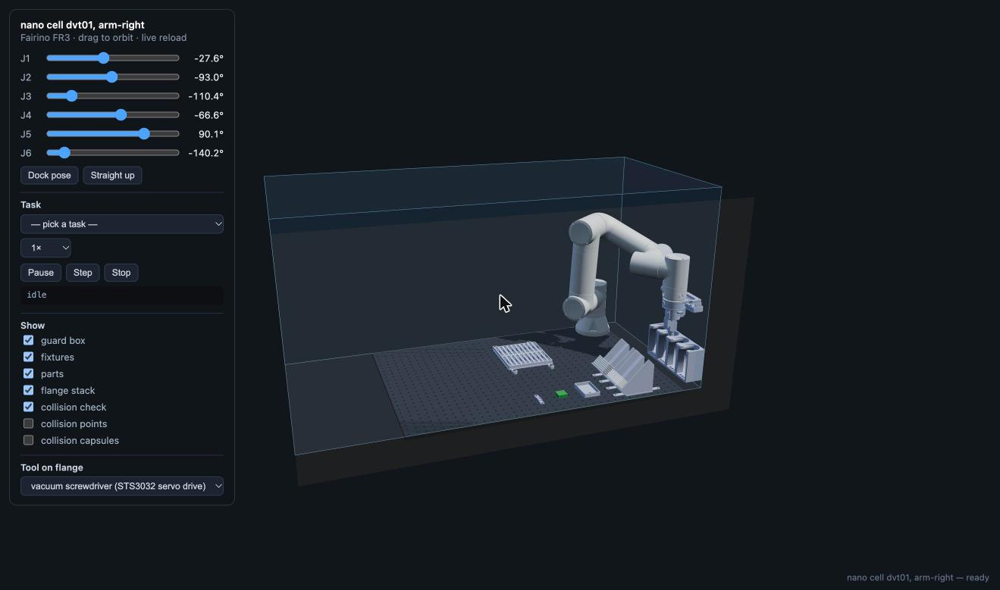

# nano-cell

A simulated robot work cell that runs entirely in the browser: a 6-axis
arm inside a guarded enclosure, collision-checked motion planning, and
tasks written as small TypeScript files. No build step, no physics
engine, no dependencies to install — one Python server, one page.



## Quickstart

```sh
python3 viewer/serve.py
# opens http://127.0.0.1:8742/viewer/ with live reload
```

Pick a task in the panel and press **Run all segments**. Edit any file —
viewer code, a task segment, cell data — and the page reloads itself.

**Agent install**: paste this repository's URL into your coding agent
with the word `install`. The agent-facing guide is [AGENTS.md](AGENTS.md)
(Claude Code also reads [CLAUDE.md](CLAUDE.md) automatically); it covers
setup, verification, and how to add or edit tasks.

Prerequisites: Python 3.8+, Node 18+ (for `npm install` and the checks),
a modern browser.

**Required — `npm install`**: the geometry and physics engine is MuJoCo
(WebAssembly, `@mujoco/mujoco`, loaded in the page). Collision checks,
contact-seeking moves, gravity settling and geometric measurements all
run on one model: obstacles box-decomposed from their collision meshes
(cavities preserved — `viewer/boxify.js`), arm and tool capsules, parts
as free bodies. Without it the scene renders but tasks are disabled.

## What's inside

- **`viewer/`** — the page and the engine.
  - `planner.js` — pure planning: commands → joint paths. FK/IK with a
    tool-frame TCP and 5-DOF free-spin solves (`ik.js`), candidate-based
    transfers (direct / corridor-lift / safe-lift, fastest clean one
    wins), collision checking against sampled geometry, contact-seeking
    moves, and measured-geometry pose helpers. Runs under `node --test`.
  - `cell-host.js` — animates planned paths in the scene, owns run
    state (grasp/release with vacuum seating, IO, pause/step/stop).
  - `collision.js` — obstacles as surface-sampled point clouds in a
    spatial hash; the moving side (arm links, tool) as fitted capsules.
    Both are visualizable live (Show → collision points / capsules).
  - `cell.d.ts` — the typed task API, fully documented for IDE hover.
- **`cell/`** — a cell is data: arm mount, enclosure, tools (with
  measured cup-lip frames), fixtures and parts with meshes + collision
  meshes, cameras, IO.
- **`tasks/<name>/`** — `task.json` (tool, segment order) and
  `segments/*.ts`. A segment is an async function against the typed
  cell API; it states intent (`transitTip`, `suctionGrasp`,
  `moveUntilTouch`) and the planner does the geometry.
- **`recipes/`** — step-by-step guides for writing segments
  (suction pick & place, holder insertion), including the pitfalls
  each step avoids.
- **`test/`** — motion regression tests: IK invariants, path quality
  (no wrist reversals, no yaw dumped into a final move), grasp/camera
  policies, footprint measurement, contact-seeking behavior.

## Design choices

- **Segments state intent; the planner plans.** Tasks survive cell
  layout changes because routes, heights, and alignments are computed
  from the live cell, not hand-taught.
- **Measure geometry, never assume it.** Placement and alignment use
  measured outlines and surfaces (`topCenter`, `topLongAxis`,
  `heldFootprintCenter`, `suctionGrasp`) — never CAD origins, frame-axis
  labels, or statistical centroids. The recipes explain why.
- **Every motion is collision-checked before it runs**, with actionable
  rejections (which link, which item, where). Deliberate contact is
  explicit (`ignore`), and set-downs seek contact instead of computing
  drop heights.
- **Speeds are tip speeds** (m/s) with per-joint velocity limits always
  enforced; the simulation answers "is this motion feasible and clean",
  not yet "exactly how fast is the cycle".

## Checks

```sh
./scripts/check.sh   # tsc --noEmit + node --test (needs Node 18+)
```

Every motion rule above is encoded as an assertion in
`test/motion.test.mjs`. If you fix a motion bug, add a test for it.

## License

MIT. Arm link meshes are converted from the arm vendor's public CAD;
see `arm/fr3/arm.json` for details.
